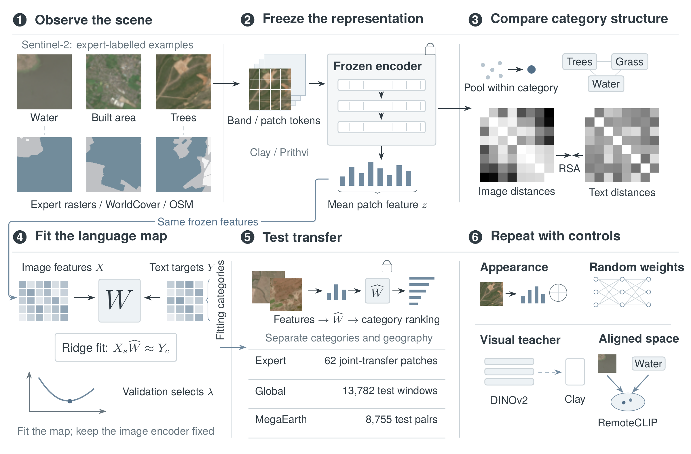
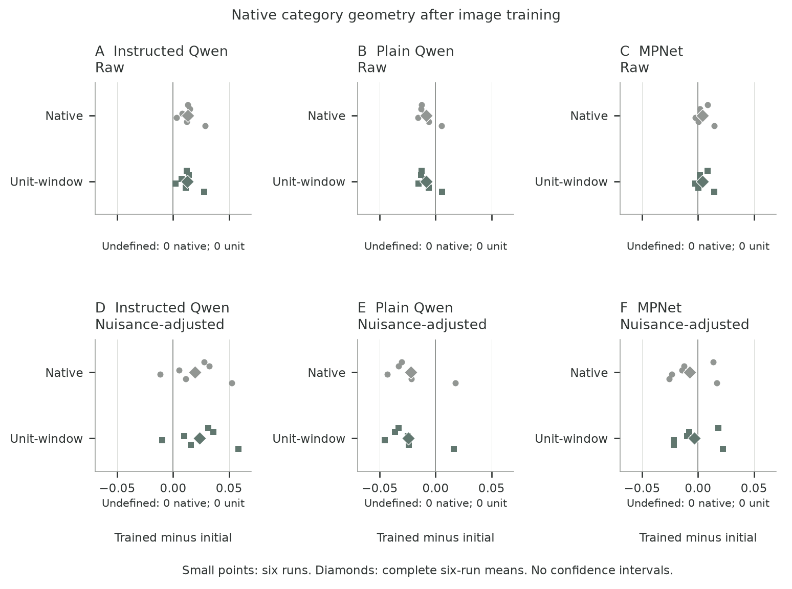

<h1 align="center">Do Geospatial Foundation Models Learn Semantic Structure from Imagery Alone?</h1>

<p align="center">
  James Edward Ball<br>
  <a href="https://orcid.org/0000-0002-1052-9747">ORCID</a>
</p>

<p align="center">
  <a href="docs/RESULTS.md">Study results</a> ·
  <a href="https://huggingface.co/datasets/Mead0w1ark/megaearth-osm-sentinel2">Dataset</a> ·
  <a href="https://github.com/JamesEBall/geofm-semantic-structure/releases">Release assets</a>
</p>

## Highlights

Geospatial foundation models learn representations from satellite imagery. This study asks whether the relationships between land-feature categories in those representations resemble relationships expressed in language, and whether a fitted image-to-language map transfers to categories excluded from training.

- **Models:** frozen Clay, Prithvi 300M and Prithvi 100M representations, evaluated against matched controls.
- **Data:** the corrected MegaEarth cohort contains 34,992 retained windows, 188 admitted classes and 91 admitted families, with 8,755 primary test pairs. Supporting experiments use expert-labelled scenes, EuroSAT and a global Sentinel-2 sample.
- **Reproduction:** pinned data downloads, saved feature assets and numerical reference results accompany the analysis code and tests.

[](assets/experiment-overview.png)

*Frozen image features support category-distance comparisons and fitted language readouts, evaluated on held-out categories and geography. Select the diagram to view it at full size.*

## Experiments

| Experiment | Question |
| --- | --- |
| Category structure | Do distances between image-category representations agree with distances between language representations? |
| Language readout | How well can a linear ridge map connect frozen image features to language embeddings? |
| Transfer | Does that map work for categories and category families excluded from fitting? |
| Controls and calibration | How much can appearance, metadata and random encoders explain, and do the uncertainty procedures meet their declared requirements? |

## Main finding

**The category supervision used to read out a representation materially changes what a GeoFM benchmark reveals about that representation.** Broader fitting vocabularies improve held-out-family retrieval at fixed image counts. Matched vocabularies preserve the tested models' mean ranking; deliberately unequal vocabularies can reverse pairwise comparisons at the same image budget. Random and nuisance controls also benefit.

A paired image-only training experiment across six initialisations improves native category correspondence with the primary language reference. Alternative references give mixed results, and the primary supervised retrieval mean changes little. This separates a training effect on category geometry from performance after fitting a supervised readout.

See [results and interpretation](docs/RESULTS.md) for the numerical findings, controls and scope. Failed uncertainty-calibration checks remain explicit: these estimates describe the evaluated cohort.

[](assets/native-geometry-sensitivities.png)

## Start here

- Read the [result tables and evidence boundaries](docs/RESULTS.md).
- Follow the [reproduction guide](docs/REPRODUCIBILITY.md) for saved-result replay or full GPU reconstruction.
- Use [DATA.md](DATA.md) for sources, pinned inputs and data licences.

## Installation

Use Python 3.12. The commands below set up a CPU environment for data checks, saved-result plots and the expert-reference analysis. The release archives can be downloaded through GitHub in a browser. The command examples use the [GitHub CLI](https://cli.github.com/).

```sh
git clone https://github.com/JamesEBall/geofm-semantic-structure.git
cd geofm-semantic-structure
python -m venv .venv
source .venv/bin/activate
python -m pip install -e . pandas pyarrow
```

Full encoder extraction requires the separate Linux/CUDA environment described in the [HPC guide](hpc/README.md).

## Data

Download the published MegaEarth tables at the pinned revision:

```sh
python scripts/download_megaearth.py --output work-megaearth
```

Each file is checked against the frozen SHA-256 manifest. Add `--imagery` to include the image archives. Cached features for the expert-reference experiments and the 47,000 geometry-confirmation records are available under [Releases](https://github.com/JamesEBall/geofm-semantic-structure/releases). See [DATA.md](DATA.md) for sources and data licences, and [NOTICE.md](NOTICE.md) for third-party notices.

## Reproduction

### Completed vocabulary and label-sensitivity extensions

The [21 October extension release](https://github.com/JamesEBall/geofm-semantic-structure/releases/tag/completed-extensions-20261021-v1) contains frozen source records, saved query scores and a portable replay for the fixed-count vocabulary, paired single-target, model-ranking and review-conditioned influence analyses. The repository and release assets are publicly available.

```sh
gh release download completed-extensions-20261021-v1 --repo JamesEBall/geofm-semantic-structure --pattern geofm-completed-extensions-20261021.tar.gz
tar -xzf geofm-completed-extensions-20261021.tar.gz
cd geofm-completed-extensions
python -m pip install -r requirements.txt
python replay.py --report ../replay-verification.json
```

The replay checks 720 endpoint estimates, 180 contrasts, 34,020 ranking rows and 540 influence rows. It reaggregates saved scores; full feature extraction and readout refitting require the external frozen inputs identified in the original records. The failed population-calibration gates and the recorded label-review design remain explicit. The completed paired training experiment has a separate archive, documented in the reproduction guide.

### MegaEarth figures

Verify the retained cohort and regenerate the support and transfer figures:

```sh
python scripts/plot_megaearth_support.py --tables work-megaearth/tables
python scripts/plot_megaearth_transfer.py
```

Outputs are saved in `output/figures/`. These commands plot the archived estimates. To rebuild features and rerun the statistical analysis, follow the [MegaEarth guide](hpc/vocab/README.md), which covers the frozen inputs, resource requirements and admission checks.

### Expert-reference experiment

```sh
./reproduce.sh
```

This downloads the original labels and cached features, reconstructs the study splits, reruns the analyses and checks agreement with the frozen results. Outputs are saved in `work/`. Add `--from-source` to rebuild features from imagery.

For the [Prithvi 100M extension](data/prithvi100/README.md):

```sh
python -m study.prithvi100 --work work-prithvi100 --check-validation
```

The [HPC guide](hpc/README.md) covers the fresh-data, global and intervention experiments, including model staging and Slurm submission.

## Validation

```sh
python -m pip install -e '.[test,hpc-test]'
python scripts/test_all.py --megaearth
python hpc/check_global_results.py
```

The tests check analysis behaviour on controlled inputs. The global-results audit verifies 768 saved estimates from 80 fold-score files. These checks preserve the study's failed statistical gates. Keep this test environment separate from the pinned HPC environment.

## Repository structure

```text
src/             Model interfaces and expert-reference analysis
scripts/         Dataset download, plots and validation commands
data/            Frozen inputs, splits and reference results
results/         Complete paired-training tables and verification receipts
docs/            Findings and reproduction instructions
hpc/             HPC runners and supporting experiments
  vocab/         MegaEarth pipeline, corrected results and calibration
tests/           Package tests
vendor/          Third-party model code and notices
```

## Licence

Original study code and associated documentation use the [MIT licence](LICENSE). [Third-party notices](NOTICE.md) and [dataset terms](DATA.md) remain applicable. Contributions are described in [CONTRIBUTING.md](CONTRIBUTING.md).

## Citation

Repository citation metadata is available in [CITATION.cff](CITATION.cff).

```bibtex
@misc{ball2026geofm_code,
  author = {James Edward Ball},
  title = {Do Geospatial Foundation Models Learn Semantic Structure from Imagery Alone?},
  year = {2026},
  howpublished = {Code and reference results},
  url = {https://github.com/JamesEBall/geofm-semantic-structure}
}
```
